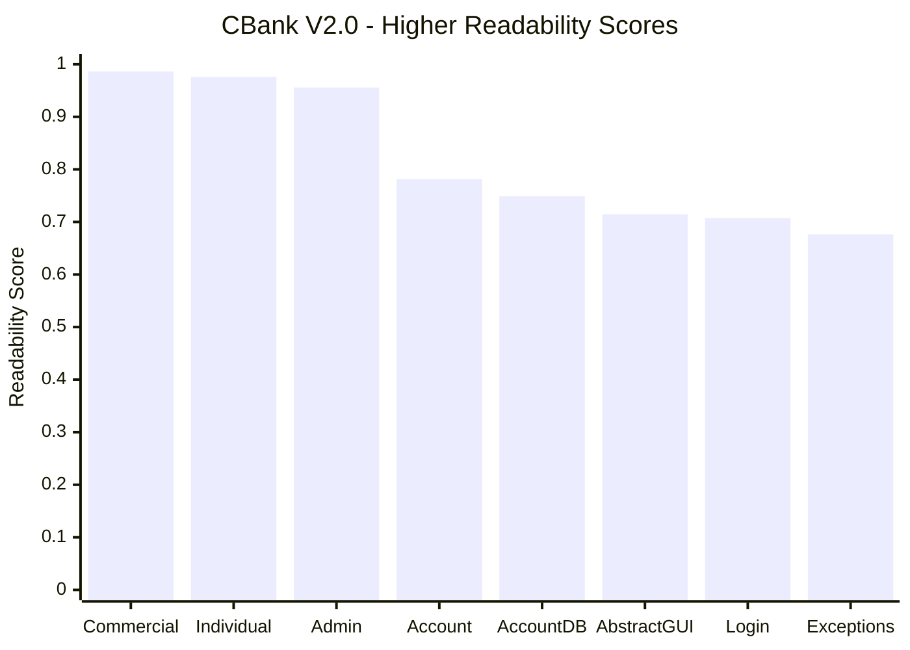
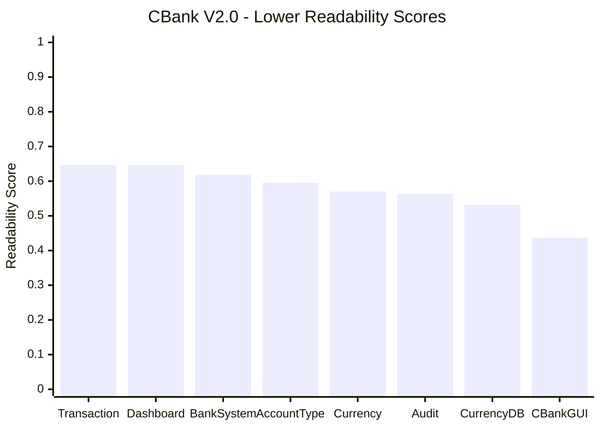


# CBank V2.0 — Source Code Readability Analysis

**Course:** SOEN 6611 — Software Measurement  
**Deliverable:** 2  
**Problem:** 6 — Source Code Readability

## 1. Objective

The objective of this measurement is to quantitatively
assess the readability of the CBank V2.0 Java source code
using an established software readability model.

Readability concerns how easily developers can read
and understand source code. Measuring readability can
help identify files that may benefit from further review
or refactoring.

## 2. Selected Readability Model

The selected approach is the **Comprehensive Model for
Code Readability**, proposed by Scalabrino et al. (2018).

The original Java-based research tool, `rsm.jar`, is used
to obtain predicted readability scores.

The model considers source-code characteristics associated
with perceived readability, including structural, visual,
and textual features.

The tool produces readability scores on a scale from
0 to 1, where higher values indicate greater predicted
readability.

The reported file-level scores are used for this analysis.

## 3. Measurement Scope

The measurement covers **all 16 production Java files**
in CBank V2.0, located under:

`Source/cbank/src/`

The source-code packages include:

- `cbank`
- `cbank.account`
- `cbank.gui`
- `init`

The following files are excluded:

- Unit tests under `Source/cbank/test/`
- Java measurement tools
- Compiled `.class` files
- External libraries and dependencies

All production Java files are discovered recursively
to include the V2.0 package structure.

## 4. Measurement Procedure

The original readability model was executed using Java
from the `Tools/Readability` directory.

### Step 1 — Collect Java Source Files

```powershell
$files = @(Get-ChildItem "../../Source/cbank/src" -Recurse -File -Filter "*.java" | Sort-Object FullName | ForEach-Object { $_.FullName })
```

### Step 2 — Verify the File Count

```powershell
$files.Count
```

Expected result:

```text
16
```

### Step 3 — Execute the Readability Model

```powershell
java -jar rsm.jar $files 2>&1 | Tee-Object -FilePath "readability_results.txt"
```

The tool produces a readability score for each Java
source file.

The original output is preserved in
`readability_results.txt`.

A separate `readability_results_clean.txt` file contains
the same measurements with shortened filenames for
easier inspection.

## 5. Measurement Results

The following scores were obtained from the original
Java readability tool.

| Java Source File | Readability Score |
|---|---:|
| Account.java | 0.7815 |
| AccountType.java | 0.5955 |
| AdminAccount.java | 0.9558 |
| CommercialAccount.java | 0.9864 |
| IndividualAccount.java | 0.9761 |
| AuditLogger.java | 0.5632 |
| BankSystem.java | 0.6188 |
| CurrencyConverter.java | 0.5701 |
| CustomExceptions.java | 0.6766 |
| AbstractCBankWindow.java | 0.7146 |
| CBankGUI.java | 0.4371 |
| DashBoardWindow.java | 0.6464 |
| LoginWindow.java | 0.7073 |
| Transaction.java | 0.6470 |
| AccountDatabase.java | 0.7488 |
| CurrencyDatabase.java | 0.5314 |
| **Unweighted File Average** | **0.6973** |

### Average Readability Calculation

The project-level readability is calculated using the
arithmetic mean of the 16 file-level scores.


$$
R_{\text{avg}} = \frac{\sum_{i=1}^{n} R_i}{n}
$$


Where:

- \(R_i\) is the readability score of file \(i\).
- \(n\) is the number of measured Java files.

For CBank V2.0:

$$
R_{\text{avg}} = \frac{11.1564798658}{16} \approx 0.6973
$$

This is an **unweighted file average**: each source file
contributes equally, regardless of its size or number
of methods.

## 6. Readability Visualization

The following charts present all 16 Java files in two
groups to improve readability.

Files are arranged in descending order of their
predicted readability scores.

### 6.1 Eight Highest Readability Scores



### 6.2 Eight Lowest Readability Scores



**Chart label abbreviations:**

- Commercial = CommercialAccount.java
- Individual = IndividualAccount.java
- Admin = AdminAccount.java
- AccountDB = AccountDatabase.java
- AbstractGUI = AbstractCBankWindow.java
- Login = LoginWindow.java
- Exceptions = CustomExceptions.java
- Dashboard = DashBoardWindow.java
- Currency = CurrencyConverter.java
- Audit = AuditLogger.java
- CurrencyDB = CurrencyDatabase.java

The complete filenames and scores are provided in
Section 5.

## 7. Results Interpretation

### 7.1 Overall Readability

The unweighted average readability score for the
16 production Java files is **0.6973**.

For descriptive analysis, a score of 0.50 is used
as the midpoint of the 0–1 scale.

- **15 files (93.75%)** score at or above 0.50.
- **1 file (6.25%)** scores below 0.50.

The midpoint is used only as a descriptive reference.
It is not an empirically validated threshold for
classifying source code as readable or unreadable.

### 7.2 Highest Readability

The highest-scoring file is:

**CommercialAccount.java — 0.9864**

The next two highest-scoring files are:

- IndividualAccount.java — 0.9761
- AdminAccount.java — 0.9558

These files received the highest predicted readability
scores in the measured source-code population.

However, high scores for relatively small files
should not be interpreted as proof of overall system
readability.

### 7.3 Lowest Readability

The lowest-scoring file is:

**CBankGUI.java — 0.4371**

It is the only file scoring below the descriptive
midpoint of 0.50.

This makes CBankGUI.java the primary candidate for
further manual readability review.

Its lower predicted readability may warrant examining
the organization, formatting, naming, and presentation
of its code.

The model's score alone does not establish which
specific characteristics caused the result.

### 7.4 Variation Across Files

The readability scores range from:

- **Minimum:** 0.4371
- **Maximum:** 0.9864
- **Range:** approximately 0.5493

This variation indicates that the model predicts
different levels of readability across the CBank
source files.


## 8. Limitations

1. The readability model predicts perceived readability
   rather than directly measuring software correctness
   or maintainability.

2. The project-level average assigns equal weight
   to every Java file, regardless of its size.

3. The descriptive midpoint of 0.50 is not a
   validated readability classification threshold.

4. Small source files may receive high readability
   scores without representing the readability of
   the entire application.

5. The model's numerical scores do not directly
   identify the specific causes of low readability.
   Manual review is necessary to investigate
   potential readability issues.

## 9. Measurement Artifacts

The following artifacts are available under
`Tools/Readability/`:

| File | Purpose |
|---|---|
| `rsm.jar` | Original Java readability measurement tool |
| `readability.classifier` | Classifier used by the research tool |
| `readability_results.txt` | Raw output with original source paths |
| `readability_results_clean.txt` | Readable output with shortened filenames |
| `readability_analysis.md` | Methodology, measurements, charts, and interpretation |
| `README.md` | Tool documentation and execution instructions |

## 10. Conclusion

The Comprehensive Model for Code Readability was
successfully applied to all 16 production Java files
of CBank V2.0.

The project achieved an unweighted mean predicted
readability score of **0.6973**.

Among the measured files, CommercialAccount.java
received the highest score (0.9864), while
CBankGUI.java received the lowest score (0.4371).

The measurements provide a quantitative baseline
for identifying files that may benefit from
additional readability review.

## 11. Reference

Scalabrino, S., et al. (2018).
*A Comprehensive Model for Code Readability.*
Journal of Software: Evolution and Process.

Research implementation:
https://dibt-research.unimol.it/report/readability/
